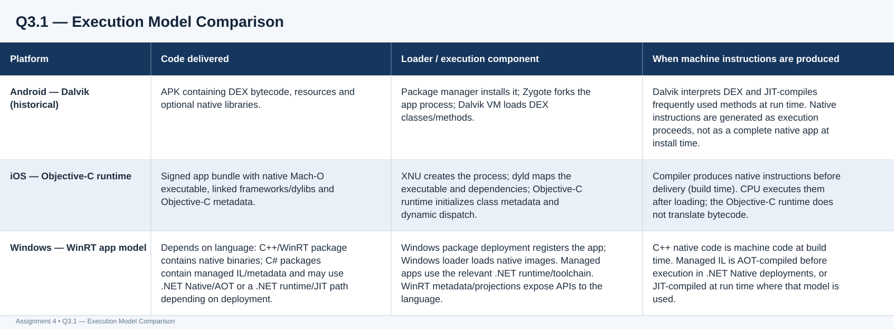
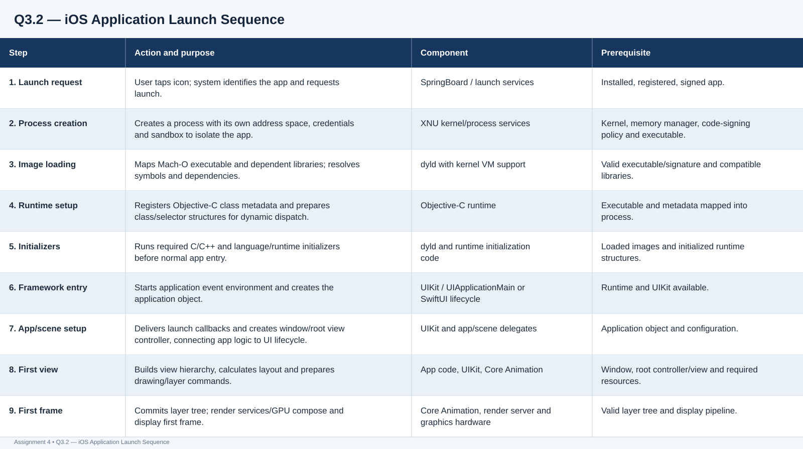
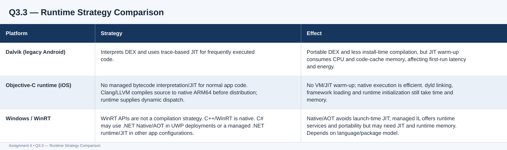
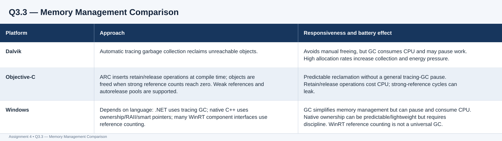
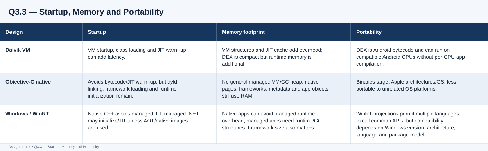
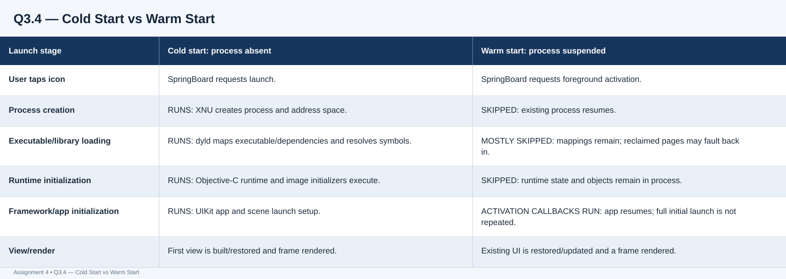

# Assignment 4 — Q3
## Task 3: Runtime Environment Analysis — From Source Code to Executing Process (9 Marks)

**Scope clarification:** Dalvik is included because the question names it, but it is a legacy Android runtime; Android 5.0/API 21 and later use ART. WinRT is a Windows API/metadata and language-projection system, not a single virtual machine. Windows execution depends on language and deployment model.

## 3.1 — Define the Execution Model (1 Mark)

**Important:** WinRT does not itself mean “bytecode runtime.” It defines Windows APIs, activation, metadata and language projections. Language and packaging determine native versus managed execution.

## 3.2 — Ordered Launch Sequence: iOS (2 Marks)

This sequence uses a UIKit app with Objective-C runtime metadata. Swift apps share the broad native process/framework path, although language-specific initialization differs.

**Purpose:** The kernel must create a protected process; dyld must map executable dependencies; the Objective-C runtime must prepare language dispatch; and UIKit must establish the event and view lifecycle. Only then can launch callbacks build the screen.

## 3.3 — Compare Runtime Strategies (4 Marks)

### A. Interpretation, JIT and AOT

- **Interpretation:** Runtime reads bytecode instructions and performs operations without first translating the entire program into native code.
- **JIT:** Frequently executed bytecode is compiled to native instructions while the app runs. It can improve repeated execution but consumes CPU and code-cache memory.
- **AOT:** Code is compiled to native instructions before execution, during build, installation or system optimization. It reduces runtime compilation but may increase package/storage or installation cost.

### B. Memory management

### C. Reaching native code and kernel services

- **Dalvik:** App calls Android framework/core APIs. Framework services use Binder IPC. Native functionality can be reached through JNI and native libraries. User-space components eventually use Linux system calls/device interfaces; apps normally do not issue arbitrary kernel calls.
- **Objective-C:** Native methods execute through runtime dispatch such as `objc_msgSend`. Apps call public frameworks such as Foundation, UIKit and Network. Frameworks communicate with services using supported IPC (including XPC/Mach messaging) and Darwin/BSD interfaces. Private kernel interfaces are not an app contract.
- **Windows / WinRT:** C++/WinRT and C# projections expose WinRT APIs in language-appropriate forms. Projection/ABI connects app code to Windows Runtime components. Lower-level access uses Win32/NT services and brokered components; packaged apps declare capabilities instead of unrestricted kernel access.

### D. Startup, memory footprint and portability

**Conclusion — low-memory device:** A small native-code design with disciplined ownership generally has the lowest runtime overhead because it avoids a managed VM and tracing-GC heap. Of the named execution models, iOS's native AOT code plus ARC offers predictable reclamation without a general GC pause. This is not an absolute ranking: native code can leak, and framework size may dominate. Modern Android ART must be evaluated separately; historical Dalvik behaviour should not be assumed for current Android.

## 3.4 — Desk-Check: Cold Start and Warm Start (1 Mark)

Same iOS app in both cases. A warm start here means the app process remains in memory but is suspended.

**Result:** Cold start pays process creation, loading/linking and runtime initialization. Warm start reuses process state and is normally faster. If the OS terminated the process, the next launch is cold even if the app was recently used.

## 3.5 — Analyse the Dependency (1 Mark)

1. **Kernel first:** A process, address space, thread, memory mappings and security context must exist before application instructions can execute.
2. **Loader second:** dyld must map the executable/libraries and resolve symbols before their functions can be called.
3. **Runtime third:** Objective-C class metadata and dispatch structures can only be initialized after the executable and metadata are mapped.
4. **Framework callbacks fourth:** UIKit can create the application object and deliver lifecycle callbacks only after process, runtime and framework code are ready.
5. **Application UI and rendering last:** App code creates the scene/view tree; Core Animation and the graphics pipeline render it.

This is a dependency chain. A UIKit callback cannot run before its process and code exist; Objective-C methods cannot be dispatched correctly before runtime metadata is initialized; and a first frame cannot be produced before the app constructs a valid view/layer tree.

## References
1. Android Developers: [Platform architecture](https://developer.android.com/guide/platform/) — DEX, ART, JIT/AOT and per-app runtime.
2. Android Open Source Project: [Android Runtime](https://source.android.com/docs/core/runtime).
3. Apple Developer: [Objective-C runtime](https://developer.apple.com/documentation/objectivec) and [App launch sequence](https://developer.apple.com/documentation/uikit/about-the-app-launch-sequence).
4. Microsoft Learn: [WinRT and C#](https://learn.microsoft.com/en-us/windows/uwp/winrt-and-csharp/) and [Windows App SDK](https://learn.microsoft.com/en-us/windows/apps/windows-app-sdk/).
